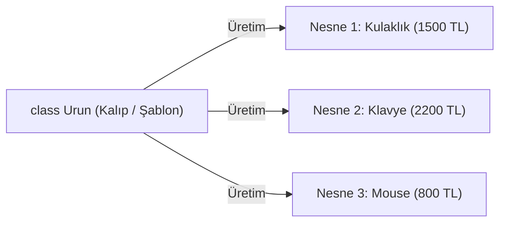
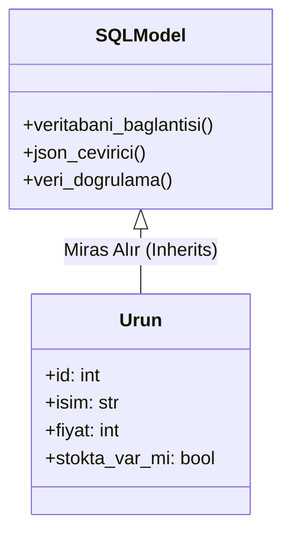

# 🧩 Backend Geliştiriciler İçin Sıfırdan OOP (Nesne Yönelimli Programlama) Rehberi

Bu rehber, Python ve FastAPI ile backend geliştirirken **OOP'nin (Object-Oriented Programming)** ne olduğunu, kodlarımızda ne işe yaradığını, neden kullandığımızı ve günlük hayattaki karşılıklarını anlamanız için hazırlanmıştır.

---

## 📌 İçindekiler
1. [Neden OOP? Düz Fonksiyonlar ve Sözlükler Neden Yetmedi?](#1-neden-oop-düz-fonksiyonlar-ve-sözlükler-neden-yetmedi)
2. [Sınıf (Class) ve Nesne (Object) Nedir?](#2-sınıf-class-ve-nesne-object-nedir)
3. [`self` Ne Demektir? Neden Her Yere Yazıyoruz?](#3-self-ne-demektir-neden-her-yere-yazıyoruz)
4. [`__init__` (Kurucu Metot) Nedir?](#4-__init__-kurucu-metot-nedir)
5. [Metotlar ve Kapsülleme (Encapsulation)](#5-metotlar-ve-kapsülleme-encapsulation)
6. [Kalıtım (Inheritance / Miras Alma) Nedir?](#6-kalıtım-inheritance--miras-alma-nedir)
7. [FastAPI ve SQLModel'de OOP'yi Nasıl Kullanıyoruz?](#7-fastapi-ve-sqlmodelde-oopyi-nasıl-kullanıyoruz)
8. [Özet Karşılaştırma Tablosu](#8-özet-karşılaştırma-tablosu)

---

## 1. Neden OOP? Düz Fonksiyonlar ve Sözlükler Neden Yetmedi?

Eğitimin ilk günlerinde ürünlerimizi sıradan Python sözlükleri (`dict`) olarak tutmuştuk:

```python
# Eski Yöntem (Düz Sözlük):
urun_1 = {"id": 1, "isim": "Kulaklık", "fiyat": 1500}
urun_2 = {"id": 2, "name": "Klavye", "ucret": 2200}  # DİKKAT: Anahtar isimleri karıştı!
```

### Buradaki Büyük Problemler:
1. **İsimlendirme Garantisi Yok:** Bir yerde `"fiyat"`, başka bir yerde `"ucret"`, başka yerde `"price"` yazabilirsiniz. Python bunu fark etmez, programınız çalışma anında patlar.
2. **Veri Tipi Kontrolü Yok:** Birisi `fiyat: "bin beş yüz"` yazsa sözlük bunu kabul eder.
3. **Veri ile Davranış Birbirinden Kopuk:** Ürünün fiyatına KDV eklemek isterseniz, gidip dosyanın başka bir yerine `def kdv_ekle(fiyat)` fonksiyonu yazmanız gerekir. Veri bir yerde, o veriyi işleyen mantık başka bir yerdedir.

> **💡 Çözüm:** Veriyi (özellikleri) ve o veriyi işleyecek fonksiyonları (davranışları) tek bir çatı altında toplamak. İşte buna **OOP** diyoruz!

---

## 2. Sınıf (Class) ve Nesne (Object) Nedir?

Bu iki kavramı anlamanın en meşhur yolu **Kek Kalıbı ve Kek** metaforudur:

* **Sınıf (Class):** Kek kalıbıdır, fabrika planıdır, boş bir form kağıdıdır. Tek başına yenmez, hafızada yer kaplamaz; sadece bir şeyin **nasıl üretileceğinin kuralını** belirler.
* **Nesne (Object / Instance):** O kalıptan fırından çıkan gerçek kektir, fabrikadan çıkan arabadır, doldurulmuş formdur.



### Kodla Görelim:

```python
# 1. KALIP (Class) Tanımlıyoruz:
class Urun:
    isim: str
    fiyat: int

# 2. KALIPTAN NESNE (Object) Üretiyoruz:
u1 = Urun()
u1.isim = "Kulaklık"
u1.fiyat = 1500

u2 = Urun()
u2.isim = "Klavye"
u2.fiyat = 2200
```
Artık `u1` ve `u2`, `Urun` sınıfından üretilmiş iki bağımsız nesnedir. Biri değiştiğinde diğeri etkilenmez.

---

## 3. `self` Ne Demektir? Neden Her Yere Yazıyoruz?

Python'da sınıfları öğrenirken insanların kafasını en çok karıştıran kelime **`self`** kelimesidir.

### Günlük Hayat Karşılığı:
Türkçedeki **"Kendi"** veya **"Benim"** zamiridir.

Bir sınıfa bir metot (fonksiyon) yazdığınızda, o metodun hangi nesne için çalıştığını bilmesi gerekir:
* "Ahmet'in maaşı" mı, yoksa "Mehmet'in maaşı" mı?
* "Kulaklık'ın fiyatı" mı, yoksa "Klavye'nin fiyatı" mı?

İşte `self`, o an **hangi nesneyle işlem yapılıyorsa onu temsil eder**.

```python
class Urun:
    def __init__(self, isim: str, fiyat: int):
        self.isim = isim    # "Bu nesnenin kendi ismi, dışarıdan gelen isim olsun"
        self.fiyat = fiyat  # "Bu nesnenin kendi fiyatı, dışarıdan gelen fiyat olsun"

    def bilgileri_yazdir(self):
        # self.isim diyerek "hangi ürün çağrıldıysa onun ismini yaz" diyoruz
        print(f"Ürün: {self.isim}, Fiyat: {self.fiyat} TL")
```

Kullanırken:
```python
kulaklik = Urun("Kablosuz Kulaklık", 1500)
klavye = Urun("Mekanik Klavye", 2200)

kulaklik.bilgileri_yazdir()  # self burada 'kulaklik' olur -> "Ürün: Kablosuz Kulaklık" yazar
klavye.bilgileri_yazdir()    # self burada 'klavye' olur   -> "Ürün: Mekanik Klavye" yazar
```

---

## 4. `__init__` (Kurucu Metot) Nedir?

`__init__`, İngilizce **"initialize" (başlatmak / ilk ayarlarını yapmak)** kelimesinden gelir.

Bir nesne **dünyaya geldiği (oluşturulduğu) ilk saniyede** otomatik olarak çalışan özel bir fonksiyondur.

```python
class Urun:
    # Nesne üretildiği anda bu fonksiyon kendiliğinden tetiklenir:
    def __init__(self, isim: str, fiyat: int):
        self.isim = isim
        self.fiyat = fiyat
        self.stokta_var_mi = True  # Her yeni ürün varsayılan olarak stokta başlasın
```

Kullanımı:
```python
# __init__ sayesinde tek satırda nesneyi eksiksiz doğururuz:
yeni_urun = Urun("Oyuncu Mouse", 800)
```

---

## 5. Metotlar ve Kapsülleme (Encapsulation)

OOP'nin en büyük gücü: **Veri ve o veriyi işleyen mantığı aynı kutunun içine koymaktır.**

### Kötü Yol (OOP Olmayan - Fonksiyonel Dağınıklık):
```python
urun = {"isim": "Laptop", "fiyat": 20000}

# Dosyanın bambaşka bir yerinde:
def kdv_hesapla(fiyat):
    return fiyat * 1.20

def indirim_yap(fiyat, oran):
    return fiyat - (fiyat * oran / 100)

son_fiyat = kdv_hesapla(urun["fiyat"])
```

### İyi Yol (OOP ile Kapsülleme):
Ürünle ilgili tüm hesaplamaları doğrudan `Urun` sınıfının içine birer **metot** olarak ekleriz:

```python
class Urun:
    def __init__(self, isim: str, fiyat: int):
        self.isim = isim
        self.fiyat = fiyat

    # Ürünün kendi KDV'sini hesaplayan metodu:
    def kdv_dahil_fiyat(self) -> float:
        return self.fiyat * 1.20

    # Ürüne indirim uygulayan metot:
    def indirim_uygula(self, yuzde: int):
        indirim_tutari = (self.fiyat * yuzde) / 100
        self.fiyat -= int(indirim_tutari)
```

Artık ürün kendi işini kendisi görür:
```python
laptop = Urun("Laptop", 20000)
print(laptop.kdv_dahil_fiyat())  # 24000.0 döner

laptop.indirim_uygula(10)        # %10 indirim yap
print(laptop.fiyat)              # 18000 döner
```

---

## 6. Kalıtım (Inheritance / Miras Alma) Nedir?

Biyolojide anne ve babanızdan saç renginizi veya boyunuzu miras alırsınız; sıfırdan bir insan tasarlanmaz.

Yazılımda da bir sınıf, başka bir sınıfın **tüm özelliklerini ve yeteneklerini miras alabilir**. Böylece aynı kodları defalarca yazmaktan kurtuluruz.



### main.py Dosyamızdaki Örnek:

```python
from sqlmodel import SQLModel, Field

# Urun sınıfı, SQLModel sınıfından miras alıyor:
class Urun(SQLModel, table=True):
    id: int | None = Field(default=None, primary_key=True)
    isim: str
    fiyat: int
    stokta_var_mi: bool = True
```

### Burada Neden Miras Aldık?
Eğer `(SQLModel, table=True)` yazmasaydık:
* SQLite tablosunu oluşturmak için onlarca satır SQL kodu yazmak zorunda kalırdık.
* JSON dönüşümü için fonksiyonlar yazmak zorunda kalırdık.
* Hatalı tipleri (`fiyat: "yazı"`) engellemek için kod yazmak zorunda kalırdık.

Ama **SQLModel atasından miras aldığımız için**, binlerce satırlık veritabanı ve doğrulama yeteneğini **bedavaya** kazanmış olduk!

---

## 7. FastAPI ve SQLModel'de OOP'yi Nasıl Kullanıyoruz?

Backend mimarisinde OOP şu 3 katmanda kullanılır:

### 1. Model Katmanı (Entities / Veri Şablonları)
Veritabanındaki her tablo bir sınıftır (`class Urun`, `class Kullanici`, `class Siparis`).

### 2. DTO Katmanı (Data Transfer Objects / Kalıtım Hiyerarşisi)
Kullanıcıdan veri alırken ID istemeyiz, ama veritabanında ID olmalıdır. Bunu kalıtımla çözeriz:

```python
# 1. Ortak Ata Sınıf
class UrunBase(SQLModel):
    isim: str
    fiyat: int
    stokta_var_mi: bool = True

# 2. Kullanıcı eklerken kullanılan sınıf (ID yok)
class UrunCreate(UrunBase):
    pass

# 3. Veritabanında saklanan sınıf (ID var ve tablo oluşturur)
class Urun(UrunBase, table=True):
    id: int | None = Field(default=None, primary_key=True)
```

### 3. Servis Katmanı (Service Pattern / İş Mantığı)
API endpoint fonksiyonlarının (`@app.get`) içine doğrudan veritabanı sorguları yığmak yerine, tüm veritabanı işlemlerini bir **Servis Sınıfına** devrederiz:

```python
class UrunServisi:
    def __init__(self, session: Session):
        self.session = session  # Veritabanı oturumunu saklar

    def tumunu_getir(self):
        return self.session.exec(select(Urun)).all()

    def id_ile_getir(self, urun_id: int):
        return self.session.get(Urun, urun_id)
```

Bu sayede endpoint fonksiyonumuz sadece 2 satıra iner:
```python
@app.get("/urunler")
def tum_urunler():
    servis = UrunServisi(session)
    return servis.tumunu_getir()
```

---

## 8. Özet Karşılaştırma Tablosu

| Kavram | Günlük Hayat Karşılığı | main.py'deki Karşılığı | Ne Fayda Sağlar? |
| :--- | :--- | :--- | :--- |
| **Sınıf (Class)** | Kek Kalıbı / Mimari Plan | `class Urun(SQLModel):` | Standart bir şablon ve veri kuralları oluşturur. |
| **Nesne (Object)** | Fırından çıkan Kek | `urun = Urun(isim="Mouse", ...)` | Hafızada yaşayan gerçek veriyi temsil eder. |
| **`self`** | "Kendi", "Benim" | `self.fiyat`, `self.isim` | Metodun hangi nesne üzerinde işlem yaptığını bilir. |
| **`__init__`** | Doğum Anı / Montaj Hattı | `def __init__(self, ...):` | Nesne üretilirken ilk değerlerini otomatik atar. |
| **Metot (Method)**| Nesnenin Yeteneği | `urun.kdv_hesapla()` | Veriyi işleyen fonksiyonları nesnenin içine gömer. |
| **Kalıtım (Inheritance)**| Anne/Babadan Gen Alma | `class Urun(SQLModel):` | Başka bir sınıfın tüm yeteneklerini tek satırda devralır. |

---

> 💡 **Tavsiye:** Kod yazarken kafanız karıştığında bu dosyayı açıp tablodan veya metaforlardan kavramın amacını hemen hatırlayabilirsiniz. Hazır olduğunuzda bu kavramları kodlarımıza parça parça uygulamaya devam edebiliriz!
